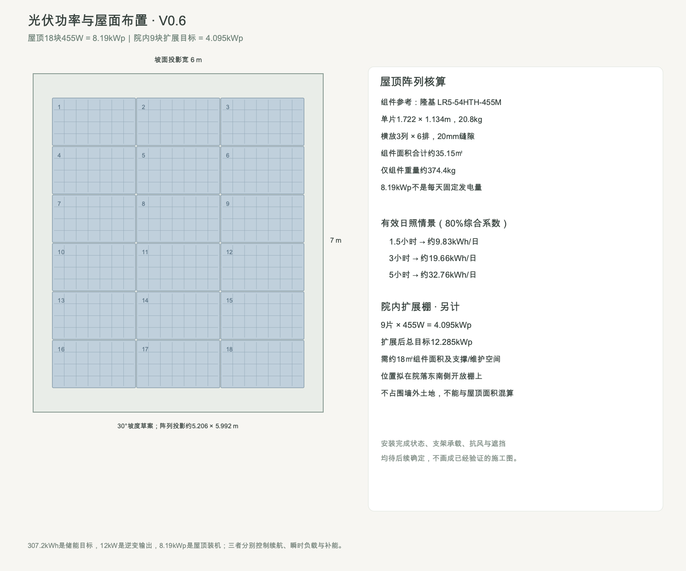

# 安全屋扩容、光伏与物资上限草案 V0.6

日期：2026-10-09。用户授权调整原30kWh储能并增加密度；本文件将“设计目标 / 设备组配范围 / 房屋结构待核 / 开局库存”分开。新目标覆盖本轮图纸，旧30kWh记录留在历史版本。**满载上限不代表开局已买齐、充满或注满，也不是现实安装可行性证明。**

[精细总览](assets/SAFEHOUSE_PLAN.png) · [逐层图与系统整理](SAFEHOUSE_ROOM_DESIGN.md) · [可复算数据](assets/SAFEHOUSE_CAPACITY.json)

## 1. 储电配电房密排目标

| 项目 | 本轮值 | 状态与含义 |
|---|---:|---|
| 电池模块 | 德业SE-G5.1 Pro-B，60块 | 每块5.12kWh；规格440×133×540mm，约45kg |
| 机柜 | 12柜，每柜5模块 | 三排四柜；柜体0.60×0.80×约1.20m为绘图预算，不是已锁定机柜型号 |
| 标称储能目标 | **307.2kWh** | 60×5.12；替代当前图纸30kWh目标，待用户审看与结构确认 |
| 逆变器额定输出 | **12kW** | 德业SUN-12K-SG04LP3-EU-AM2-P参考，三相；不因增加电池而提升输出 |
| 交流可用能量算例 | 254.36kWh | 307.2×90%使用比例×92%转换比例；不是厂商整套实测值 |
| 电池质量 | 2700kg | 60×45；12柜另按30kg/柜预算共360kg |
| 整套质量估计 | 约3.2～3.5吨 | 包括柜体、逆变、配电、承托等预算，不能只用平均kg/㎡判承重 |
| 设备组配边界 | 厂商最高64块并联 | 本方案60块超过32块免外部配置范围；外部配置、BMS/固件及保护分组待核 |

三排四柜占据房间主要可用设备区，两条排间操作通道保留，门口与通道不中断；图中三角表示开柜方向。后侧维护可利用排间空间，未同时承诺每排还有独立0.6m后检修带。三层既有楼板、梁柱、柜脚集中荷载、设备搬运、分隔与散热都需具体确认。

12kW为额定交流输出。参考逆变器电池侧240A上限，51.2V时约12.29kW，43.2V低电压时约10.37kW，转换后还会降低；电池独供不保证所有SOC下都能输出12kW。三相接入及所选整套兼容尚未完成核验。

| 日总用电假设（含服务器、通风与自耗） | 无光伏补充的续航算例 |
|---|---:|
| 6kWh/日 | 约42.4天 |
| 10kWh/日 | 约25.4天 |
| 16kWh/日 | 约15.9天 |

这些是电池满载且按假设使用的能量算例；资金来源、开局装机/电量及B/C路线差距另定，不能据此让第一章家庭已拥有数吨电池。

## 2. 光伏功率与屋面面积

已画南向坡面为6×7m投影。暂按30°坡度，采用隆基LR5-54HTH-455M的尺寸参考：1.722×1.134m、20.8kg/片。横放3列×6排、间隙20mm，18片阵列投影约5.206×5.992m，落入扣除周边维护预算后的约5.4×6.4m空间。该高度经过复算，不能用组件坡面长度直接当水平投影长度。

- 屋顶18×455W＝**8.19kWp**；组件面积约35.15㎡，仅组件重约374.4kg，支架另计。
- 院内开放棚可另设9片，功率**4.095kWp**，组件面积约17.57㎡及另计维护/支撑空间。
- 扩展后总目标**12.285kWp**。扩展棚拟在院落东南侧，不占围墙外土地，不阻塞两车角落、院门与步行路径；位置、阴影与棚柱仍待细化，不视为开局全部建成。

| 假设有效日照 | 屋顶8.19kWp × 日照 × 80%综合系数 |
|---|---:|
| 1.5小时 | 约9.83kWh/日 |
| 3小时 | 约19.66kWh/日 |
| 5小时 | 约32.76kWh/日 |

这是天气压力情景，不是庐州实测预测。扩大电池不会增加每天发电。按3小时情景、日耗6kWh，理想净余约13.66kWh/日；**即使不计充电损耗**，补回90%标称电量也约20.2天，实际还受天气、限流与损耗影响，不写成“大电池很快充满”。

## 3. 地下食品架与全屋食品上限

食品区改为16组0.85×0.55×1.90m四层钢架：北排6组、中央4组、南排6组。两条取物通道约0.95m，中央两端保留绕行，入口不被柜体封住。

| 计算项 | 结果 |
|---|---:|
| 货架占地 | 16×0.85×0.55＝7.48㎡ |
| 四层置物面 | 7.48×4＝29.92㎡ |
| 包装可用体积算例 | 7.48×1.6m有效高×70%填充＝约8.38m³ |
| 地下食品质量管理目标 | 2,000kg |
| 楼上轻量食品额度 | 约100kg（300L分配、300kg/㎥混合包装密度估计约90kg，管理值取整） |
| 全屋食品上限草案 | **2,100kg** |

同尺寸货架的层板承载参考130kg/层，但64层额定值之和8.32吨**不是住宅承重上限**。2吨食品也只是待核的游戏管理目标；架脚、地下结构和食品包装体积分别核算。湿度与防潮必须处理，移动除湿机只是备用位置，不能认定关门隔间都已满足长期食品储藏环境。

以本轮热量算例：米面150kg、豆20kg、油10kg、混合罐头80kg、饼干20kg、奶粉10kg、坚果10kg、糖5kg，共305kg。采用数据文件中待SKU核实的圆整热量，合计992,000kcal；预留10%损耗、四人每天各2,000kcal时，约**111.6天热量当量**。它不是均衡食谱或现实存活保证，也不是B/C开局清单。

## 4. 储水上限与四人用水

原0.9m门不适合直接搬入常见1.0m宽的1000L IBC。因此本轮画12个220L桶，参考外径0.581m、高0.935m，图中按Ø0.60m预算；空桶搬入再注水，单层落地，不叠放。用于饮水的桶必须有适当食品接触资质，不能用普通工业桶替代。

| 容器用途 | 标称容量 |
|---|---:|
| 6个饮用/烹饪水桶 | 1,320L |
| 6个独立生活用水桶 | 1,320L |
| 24个20L饮水罐 | 480L |
| 地下20箱×12L瓶水 | 240L |
| 楼上分散瓶水 | 120L |
| **饮用/烹饪容器合计** | **2,160L** |
| **生活水容器合计** | **1,320L** |
| **总容器上限草案** | **3,480L** |

12桶两排放，西侧取用与房门保留通道。单桶水重220kg；Ø0.581m外包络上的仅水重平均约830kg/㎡，实际接触更集中；地下板仍需核验，不能把“放地下”当成承重保证。

| 四人日消耗情景 | 饮烹水单独天数 | 生活水单独天数 | 两类同时维持 |
|---|---:|---:|---:|
| 每人3L饮烹＋8L生活 | 180天 | 41.25天 | 约41天 |
| 每人4L饮烹＋8L生活 | 135天 | 41.25天 | 约41天 |
| 每人4L饮烹＋20L生活 | 135天 | 16.5天 | 约16天 |

3/4/8/20L是分用途的游戏情景参数，不是现实人群统一定额。CDC应急储水建议与本游戏分类不同，包含饮用、做饭和刷牙等；本表不把生活水自动转为饮用水。容器容量也不保证安全储存期限或已注满。

## 5. 客厅、卧室及医疗耗材扩容

避免把日常空间变成无序纸箱堆，本轮采用应急状态才展开的低箱/家具收纳：客厅6×60L，一层临时客房4×60L，父母/情侣/三层客房各2×40L。名义箱容积840L，75%装箱率约630L；全屋统一采用**600L应急可用包装体积管理额度**，不再把每个柜子与箱子重复相加。

分配初稿：轻量食品300L，医疗耗材/药品收纳160L，卫生与轻杂物140L。地下大宗粮、水不随空房体积继续上楼堆高。楼上120L瓶水拟分配：客厅48L、一层客房48L、父母12L、情侣12L。

医疗160L可按一层干燥主柜100L、父母抽屉20L、三层楼面急救盒合计30L、随身包10L分配；主要包括敷料、手套与急救用品，不能全部画成药盒。不要放卫浴、洗衣热湿区、服务器机柜或电力房。药品种类、有效期、冷藏与处方需求分别确定，不能把160L直接换成“够用几个月”。

## 6. 房间美感与服务器办公

- 父母卧室：北向床、双床头柜、窗边阅读椅，胡桃木与灰蓝；低柜承接日常药箱。
- 情侣卧室：南向床、梳妆兼阅读桌，浅木、鼠尾草绿与淡紫；床与衣柜位置不复制父母房。
- 三层客房：东西向抽屉日床、独立小桌与阅读角，亚麻与浅砂色；抽屉可接轻箱。
- 服务器房：正式办公桌、书架、阅读椅和边几，机架留东向操作空间，兼书房/办公室。Mac mini、网络和小UPS不变，不新增算力设备。

## 7. 实现与下一轮

本轮保存了容量计算数据与房间陈列图。上限、荷载条件、路线实际库存必须分别进入系统；第一章仍纯视觉小说，不提前显示生存数值面板，不改写已认可剧情。

应继续确定：三层结构承托/搬运、配电组配与电池配置、院内光伏棚、地下板荷载、温湿度、实际食物SKU与采购预算，以及B/C抵达时填充比例。没有这些信息时，不把满载设计图当成已经发生的家庭事实。

## 8. 核对来源

- [德业电池官方手册](https://deye.com/wp-content/uploads/2026/03/deye-ess-user-manualse-g5.1-pro-b-deen-v05_20260314.pdf)：5.12kWh、45kg及64/32并联边界。
- [德业AM2-P逆变器官方规格](https://www.deyeinverter.com/deyeinverter/2026/04/25/BDatasheetSUN-5-12K-SG04LP3-EU-AM2-P20260424en.pdf)：12kW、240A及三相机型。
- [隆基455W官方组件规格](https://static.longi.com/L_Gi_LE_PM_T_PMD_059_F131_LR_5_54_HTH_445_455_M_V1_30_30_and_15_V19_CN_pdf_0d6d76b347.pdf)：组件形态/尺寸及额定功率参考。
- [IKEA BROR官方规格](https://www.ikea.com/gb/en/p/bror-shelving-unit-black-s89617443/)：85×55×190cm与每层承载参考，不绑定游戏品牌。
- [MAUSER桶目录](https://mauserpackaging.com/wp-content/uploads/2022/02/201909_Mauser_BRO_PE-Packaging_A4.pdf)、[SCHÜTZ IBC尺寸](https://www.schuetz-packaging.net/downloads/datenblaetter-ibc/datenblatt-ecobulk-mx-1000/datasheet-schuetz-ecobulk-mx-en.pdf?cid=373m)：搬入包络与容器资质边界。
- [CDC应急储水](https://www.cdc.gov/water-emergency/about/how-to-create-and-store-an-emergency-water-supply.html)、[USDA耐储食品](https://www.fsis.usda.gov/food-safety/safe-food-handling-and-preparation/food-safety-basics/shelf-stable-food)：储藏环境与水的用途/轮换边界。
- [FDA热量参考](https://www.fda.gov/food/nutrition-facts-label/calories-nutrition-facts-label)、[FDA储药资料](https://www.fda.gov/drugs/safe-disposal-medicines/dont-be-tempted-use-expired-medicines)：2,000kcal只是一般参考，药品不能按体积推算疗程。
