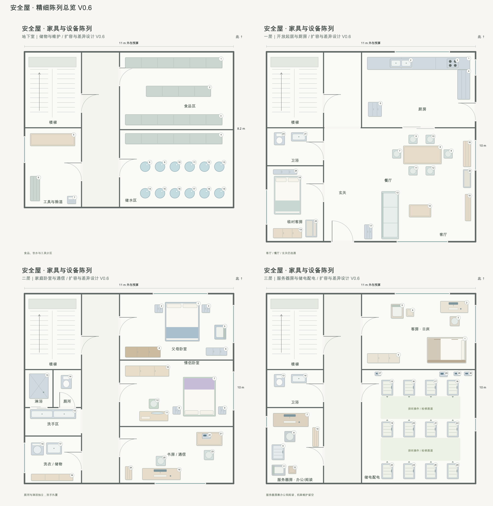
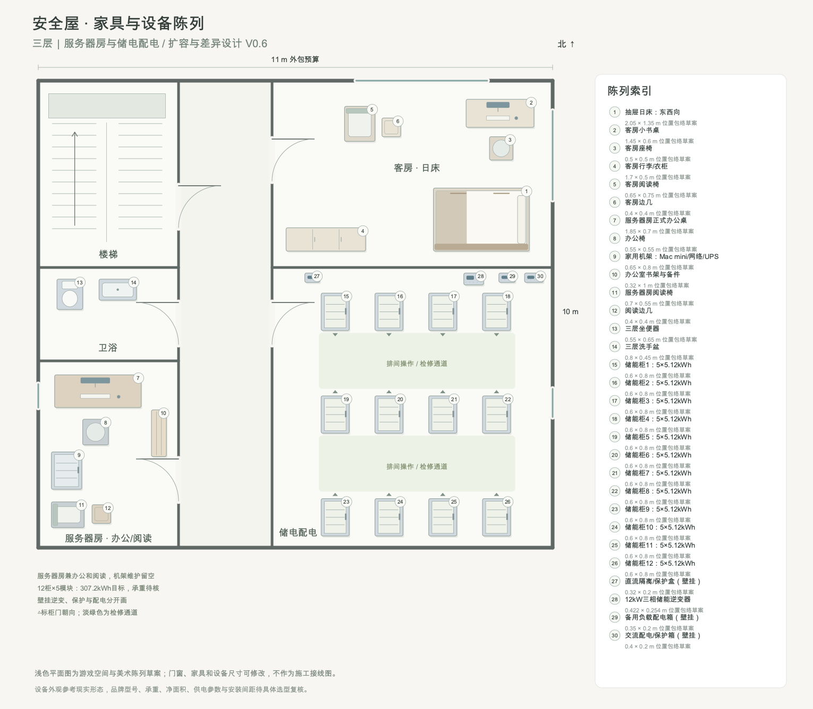

# 安全屋户型草图 V0.6

修订日期：2026-10-09。当前主图为四层精细陈列总览，另有单层大图、设备正面图和屋顶/院落参考页。

[矢量版](assets/SAFEHOUSE_PLAN.svg) · [空间数据](assets/SAFEHOUSE_LAYOUT.json) · [系统整理与单层精细图](SAFEHOUSE_ROOM_DESIGN.md) · [家具索引](assets/SAFEHOUSE_FURNITURE.json)

## 布局基准

北向上。地上各层外包预算11m×10m，约110㎡；面积包含墙体与交通预算，不是净使用面积。地下室11m×8.2m，约90㎡。用地边界暂按15m×17m预算255㎡，住宅占地110㎡，外部院落约145㎡，仍落在原100～150㎡范围内；其中包含车辆、设备与通行空间。院落与楼层图采用不同显示比例，不将住宅面积重复算进院落。

三层楼梯统一在西北侧；卫浴上下叠放，降低管线错位。二、三层保留公共通道，各房门由公共区域进入；一层取消客厅、餐厅、玄关之间的隔墙，楼梯厅向开放起居空间连通。

一层南侧玄关直接进入开放客餐厅，餐桌与沙发以家具划分区域，不另砌墙；厨房仍保留隔门及室外侧门。二层有父母与情侣两间卧室，以及东南书房/通信桌。原单一卫浴改为独立厕所、独立淋浴和外置洗手台，门从公共洗手区进入，洗衣储物保留在南侧；厕所以及淋浴的湿区仍尽量叠在一层卫浴上方。三层有客房、卫浴、服务器房和电力储存设备间。西南原杂物间改为服务器房（分区预算约12㎡），东南原多功能房改为电力储存设备间（分区预算约36㎡），两间独立进出，不再保留未定义的多功能用途。地下室是储藏和维护空间，留楼梯与通道。

屋顶保留楼梯出口与维护通道，北侧服务平台东北角布置天线，南向坡面布置光伏。馈线虚线沿东侧进入二层书房，固定台不放地下室。屋顶形状会在中式外立面草图中进一步对齐。

院落取消车位划线和独立停车分区，两辆车集中在西南角，沿院墙东西向停放，按约5m×2.1m车辆包络做空间预算。南侧院门暂按4.5m宽，步行到正门的路径避开车辆；可通过倒车调整出入，不预设可以原地掉头。其余前院留作生活、搬物与设备检修。具体车型转弯轨迹仍需核算。

## 三层设备用途

服务器房兼书房/办公室，存放Mac mini、外接存储和家庭网络设备，已绘正式工作桌、书架、阅读角与家用机架，不凭房间名称新增大型服务器集群。Mac mini从此前二层书房迁至此处；二层仍保留家人工作桌和FTM-6000R固定电台。

电力储存设备间按本轮授权改为12柜60模块、307.2kWh密排目标，以及12kW逆变器、配电和保护设备；这里的“变电”按家用光伏逆变与配电理解，不增设高压变电站。原30kWh已被扩容草案覆盖；具体组配、安装环境、承重、设备散热、检修与电气隔离另行核算，不能称为已实现的三层安装。设备位置是游戏空间初稿，不宣称现有结构已经完成安装验算。

服务器和电力设备分室；食品储存仍在地下室。屋顶天线的RF馈线与电力设备线路分开组织，电台继续在二层，不用电力房替代通信桌。院落原设备小框改为工具收纳，不再表达主储能位置。

**精绘更新：** 门的位置、柜体、洗衣水盆及书房资料架以V0.6单层大图为当前陈列初稿；淋浴入口采用滑门，楼梯门向公共楼梯厅打开。储电配电房以三排四柜、独立壁挂逆变/保护/交流配电/备用负载箱表达，标称容量目标307.2kWh、额定输出12kW，柜间保留操作通道。详细依据及三轮检查见系统整理文档。

## 本轮门窗与家具细化

- 层高暂按3.2m，西北侧楼梯采用U形双跑示意，约19～20级；楼梯间继续上下同位置，踏步尺寸不据此定为施工参数。
- 外墙厚度预算约240mm、普通隔墙约120mm；图中的矩形分区为建筑面积预算，尚未扣除墙体，不声称每间净面积。
- 主门暂按1.1m、卧室门0.9m、卫浴门0.8m；厨房隔门与东侧门保留。
- 图中青灰短线为外窗初稿：卧室与书房有外侧采光，客厅朝南；不能在后续外立面中随意移动这些窗。
- 一层餐桌、沙发、电视及厨房操作台仅作为布局参考，客餐厅与玄关仍开放。二层补床、洗手台、洗衣机及工作桌；固定台保持书房位置。

**V0.6陈列更新：** 卧室床朝向、衣柜、阅读/梳妆配置分别设计；地下架与桶加密，客厅和卧室增加应急收纳。能源、光伏和食品/水上限详见[扩容核算](SAFEHOUSE_CAPACITY.md)，不将满载图当成开局库存。

## 仍需细化

- 外墙与承重布局、墙厚、楼梯踏步、门窗尺寸、每间净面积；现图不作为施工尺寸图。
- 侧门外部路径、院门宽度、两车实际转弯与停放空间。
- 屋顶坡度、光伏组件面积及遮挡、桅杆固定和天线线路的专业安装条件。
- 地下室采光、防潮、通风及独立能源设备空间；不因有地下室默认其能安全应对所有灾害。

剧情已认可的住所、院墙、光伏与地下储备不变。后续美术需保持同一建筑外观与内部空间对应；无需把所有房间一次展示给玩家。
