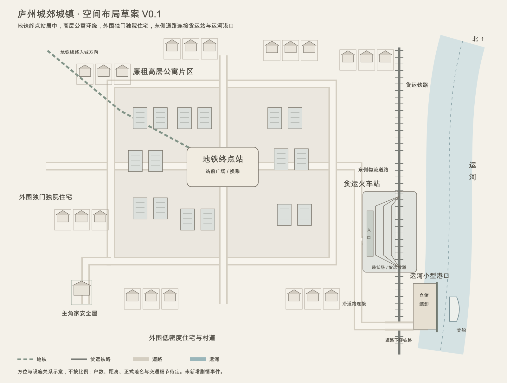

# 庐州城郊城镇空间地图 V0.1

日期：2026-10-09。按用户指定的中心、居住圈层与物流节点绘制。

[可编辑矢量版](assets/TOWN_MAP.svg) · [布局数据](assets/TOWN_LAYOUT.json)

## 已指定的关系

- 地铁终点站位于城镇中心，站前广场承担居民出入与换乘。
- 中心周边为廉租高层公寓，生活密度较高。
- 外围是独门独院的低密度住宅，安全屋属于这一层次。
- 沿道路连接货运火车站与运河小型港口。

## 本轮方位初稿

地铁从西北方向进入，在中心终止；货运铁路另置于东侧物流走廊。社区道路由中心连接货运站入口，再延伸至运河西岸小港口。铁路与去港口的道路交叉处先画下穿通道，避免在示意图中把两者画成可以随意穿越的交叉线。

安全屋先放在外围西南住宅区，通过村道连回社区道路。外围住宅不默认荒废，高层公寓住户不默认敌对，车站和港口也不默认无主资源点。

## 后续细化

此图表示方位与设施关系，不按比例；建筑图标不代表确定户数。正式城镇名、地铁线名、区域实际距离、居住人口、运河航道和铁路道路工程尚未定稿。既有世界观的农业、小型工业及其他交通设施暂未全部画入，不据此删除这些设定。

本图没有新增剧情、任务或资源库存；后续再根据尺度与交通条件确定步行、开车及无线电可达性。
