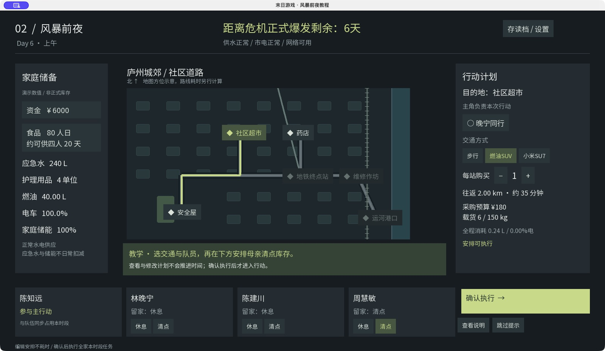
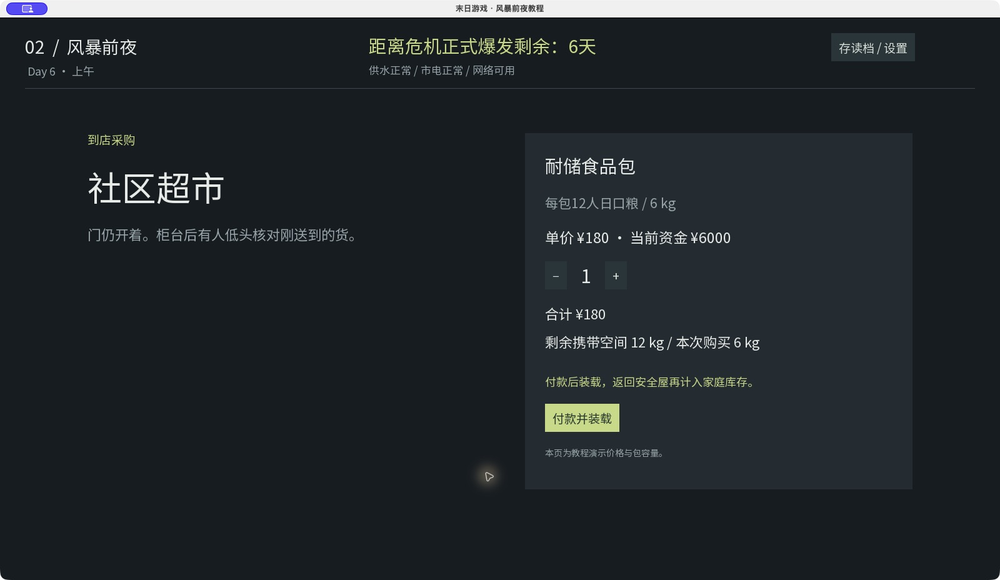
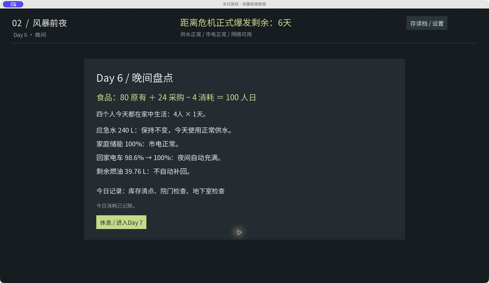

# B线Day 6教程与SLG界面 V0.1

制作日期：2026-10-12。载体：现有Ren’Py原生桌面程序，1600×900。
状态：一天可玩教程；完整第二章、C线教程和支线长剧情尚未实现。

## 时间与入口

B线Day 5晚抵家，Day 6早晨开始操作，距离危机爆发剩6天；C线仍Day 2晚抵家、Day 3开始操作，差三天。第一章B04末新增两天工作交接与采购整理过渡，B05—B07改为Day 5，其他路线正文不改。

B线第一章结尾可进入第二章。主菜单也有“第二章 · B线教程（演示）”，用于直接审看，本入口不额外解锁成就。C线结尾保留现有解锁提示，不跳入B线初始化。

## 开场剧情与教学

### 早餐：桌上的两张清单

旁白：早餐还没有收走，父亲已经把两张纸放在桌上。一张是购物小票，另一张写了又划掉。

周慧敏：吃的买了一些。先看看，别又买一堆放不下的。我们四个人，每天都要吃。

陈建川：附近超市走过去就行。搬得多就开车，别提到半路又回来找车。水电现在还正常，备用的先留着。

林晚宁：把每天用的和准备留下的记清楚吧。我把附近的路找出来。

旁白：手机上的地图还正常加载。院外有人骑车经过，铃声隔着玻璃传进来。

### 上午：第一次采购

1. 点食品查看库存与支持天数。早餐不扣口粮。
2. 点地图上的社区超市。道路高亮显示往返路线。
3. 主角出门，可安排晚宁同行；其他家人留家。安排母亲清点库存，不发放新物资。
4. 选择步行、燃油SUV或小米SU7，查看时间、载货与油电成本。修改计划不耗时。
5. 确认执行。人物或车辆图标沿道路移动；动画可以加速或跳过。
6. 到店剧情后选择食品包数量，付款装载；超载或资金不足时不能付款。
7. 回家后物资入库，显示行动结果。至少一个食品包能用全部三种交通方式带回。

超市场景：门口停着几辆电动车。店员正在把新到的货摆上架，纸箱还没有拆完。

陈知远：先买能放的。今天不一定要把所有东西买齐。

### 下午：自由安排

可以检查地下室、检查院门、去药店或再次采购。选择超市或药店时，可以顺路添加另一家店；路线、预算、载货按两站累积计算。未安排的家人休息；家人可以留家清点或检查。

地下室检查只发现箱底受潮并留下记录，不自动修复、赠送储藏架或宣布支线完成。院门检查只发现铰链和蹭地问题，后续维修尚待扩写。留家人员发现问题时，也播放对应的简短汇报。

药店场景：店员隔着柜台核对清单。旁边的人都在看手机，偶尔有人抬头问一句。

### 晚间：今天买回来的东西

周慧敏：今天吃掉多少，也记一下。不能只记买回来的。

林晚宁：车在院里充着电。明天可以接着用。

陈建川：有油的那辆不会自己补回来。出门之前看一眼。

旁白：父亲把清单折好，放在桌角。外面的街灯亮起来了。

晚间显示食品收支式，扣四人全天共4人日口粮。正常供水不扣应急水，家庭储能保持满电，回家电车自动充满，燃油保持实际剩余量。进入Day 7后展示教程完成页，并保存本日成果；后续日程尚待接入。

## UI与状态

- 顶栏：第二章、倒计时、日期时段、供水/市电/网络、存读档和设置。
- 左栏：资金、食品、应急水、护理用品、油电。
- 中央：安全屋西南、地铁居中、维修及港口在东侧；路线独立计算，不按图像像素估算距离。
- 右栏：目的地、主角与可选同行者、交通、包数、多站、成本与错误原因。
- 底栏：四人排班与执行按钮。
- 窗口：物资详情、操作说明、采购、行动结果、晚间盘点。

主角负责本轮主行动，晚宁可同行或协作，父母和未同行的晚宁可留家行动。本轮不是完整多人独立外出系统；主路线只占用一辆车，同行人员不再允许同时留家执行。

教程引导可跳过并随时查阅；跳过不采购、不增加资源。上午浏览和教学暂停时间，实际出行占用上午，下午自由安排占用下午。

## 演示参数

所有参数集中于game/ch02_demo.json，均为游戏预算，不表示真实车况或正式库存。

| 参数 | 演示值 |
|---|---|
| 资金 | 6000元 |
| 食品 | 80人日 |
| 应急水 | 240L |
| 燃油 / 电车 / 家庭储能 | 40L / 100% / 100% |
| 护理用品 / 建材 | 4 / 6单位 |
| 食品包 | 180元、12人日、6kg |
| 护理包 | 90元、1单位、2kg |
| 步行携带 / SUV载货 / 电车载货 | 单人12kg / 150kg / 100kg |
| 时段上限 | 240分钟；往返路程与每站30分钟合计检查 |

房屋储能容量、食品和容器管理上限仍按当前设定专题维护，不以这些演示值覆盖。主游戏沿用原存档目录；本次独立交付App使用ApocalypseGame-Ch02TutorialDemo，避免混入第一章演示存档。

## 实现与验证

模型每次产生独立状态快照；界面修改通过retain_after_load保留；采购、返家入库、晚间结算有状态保护。模型测试包括三种交通、状态不污染旧快照、超载/资金/油电/时间不足、同行与留家冲突、多站与并行检查、重复购买/入库/结算拒绝以及跳过提示不赠送资源。

真实界面验证：规划保存后修改交通再加载，恢复原SUV和母亲清点；采购后保存并加载，库存92、资金5820、燃油39.76保持；下午电车访问药店和超市，并行房屋检查；晚间80＋24－4＝100人日、电车98.6%→100%、应急水240L；加载晚间存档仍为100人日，进入Day 7显示剩5天。

第一章生成校验：保持30节点、四选一、三个成就；对照本轮修改前的工作稿核对A/C/D与共通正文未改。Ren’Py lint与运行截图分别记录于交付说明。

## 尚待实现

完整六天日程、支线期限和成功失败后续、六人入住与消耗变化、完整多队外出、正式数值平衡、事件风险与大规模地图内容。林晚宁父母接应仍保留在PLANNING.md，未在本教程中默认入住。

## 原生程序截图

## 2026-10-12 · 原地图与距离矩阵更新

当前代码改用原城镇地图，详情与最新距离值见[TOWN_ROUTES_V0.4](TOWN_ROUTES_V0.4.md)。上文V0.1油耗和截图保留为历史测试记录，不作为新路网结果。地图版使用独立存档。
